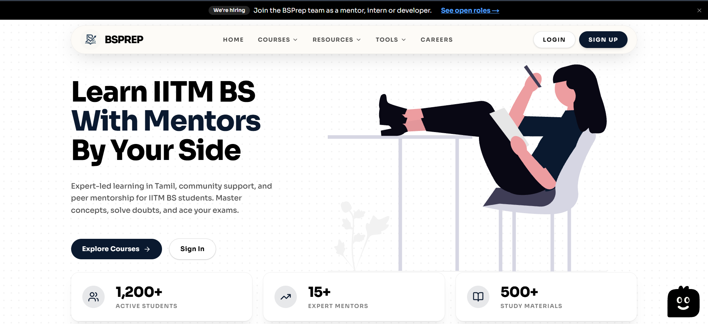
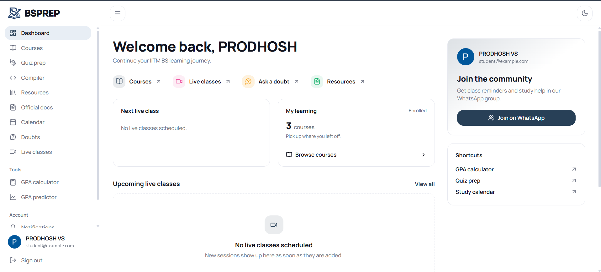
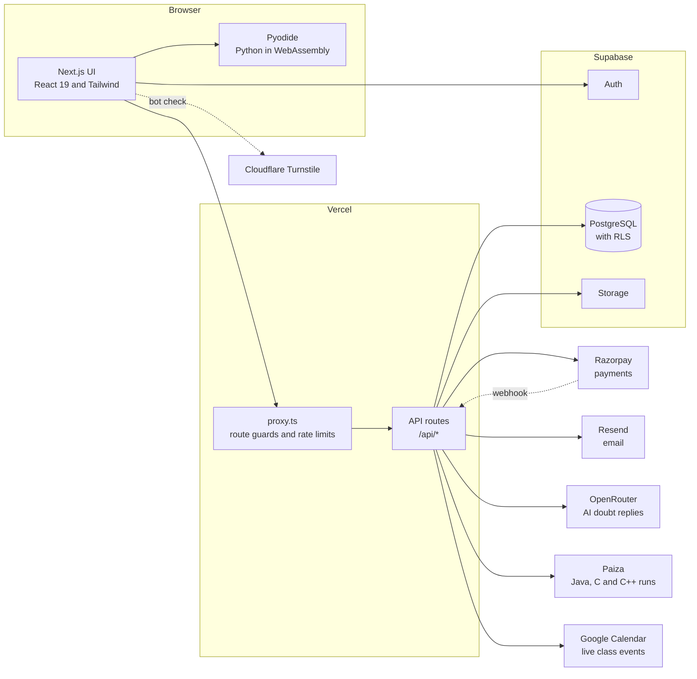
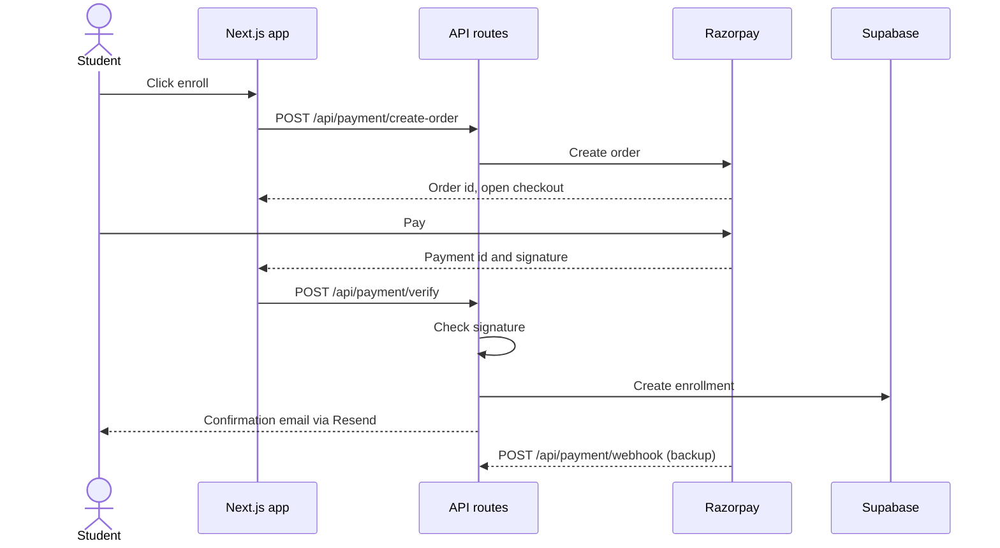

<p align="center">
  
</p>

<h1 align="center">BSPrep</h1>

<p align="center">
  Tamil-medium prep for IITM BS students, built by students who have been through it.
</p>

<p align="center">
  <a href="https://bsprep.in"><b>bsprep.in</b></a>
  &nbsp;·&nbsp;
  <a href="https://bsprep.in/compiler">Online compiler</a>
  &nbsp;·&nbsp;
  <a href="https://bsprep.in/careers">We are hiring</a>
</p>

<p align="center">
  
  
  
  
  
</p>

<br />

<p align="center">
  
</p>

## What is BSPrep

Most people who start the IITM BS program have no clear idea how to prepare for the Qualifier, and almost nothing exists for it in Tamil. BSPrep fills that gap.

You get video courses in Tamil, weekly live classes with mentors who have already cleared the Qualifier, a place to ask doubts, GPA tools, and a compiler that runs in the browser. It is one account and one dashboard instead of five tabs.

BSPrep is an independent student project. It is not an official IIT Madras product.

<br />

<p align="center">
  
</p>

## What you can do

| Feature | Details |
|---|---|
| **Courses** | Tamil video lectures for Qualifier and Foundation subjects, plus bundles and completion certificates |
| **Live classes** | Weekly sessions per subject with recordings, scheduled through Google Calendar |
| **Doubts** | Ask in public or private. Mentors answer, and an AI assistant gives a first reply |
| **Compiler** | Python, Java, C and C++ in the browser. Multi-file editor, share links, no sign in needed |
| **GPA tools** | Course grade calculator, semester GPA and a predictor that tells you the exam score you need |
| **Resources** | Community notes for every subject, with stars and a contributor leaderboard |
| **Three dashboards** | Student, mentor and admin, all on one design system with a dark theme |
| **Admin inbox** | Send announcements and campaigns with one-click unsubscribe |

## Architecture

Everything runs on Next.js. Pages and API routes live in one app on Vercel, `proxy.ts` guards the private routes, and Supabase handles auth and data. Anything that needs a secret key stays on the server.



### How a payment flows

The server never trusts the browser. The order is created server-side and the payment signature is checked before anyone is enrolled. A webhook covers the case where the user closes the tab after paying.



> Enrollments are currently closed. Flip `ENROLLMENTS_CLOSED` in `lib/course-catalog.ts` to reopen checkout everywhere.

### Roles

| Role | Lands on | Can do |
|---|---|---|
| Student | `/dashboard` | Courses, live classes, doubts, tools, notes |
| Mentor | `/mentor` | Run live classes and answer doubts for assigned subjects |
| Admin | `/admin` | Users, enrollments, announcements, inbox, analytics, subject assignment |

## Tech stack

| Area | Tools |
|---|---|
| **Framework** |  Next.js 16 (App Router) &nbsp;  React 19 &nbsp;  TypeScript |
| **Styling and UI** |  Tailwind CSS v4 &nbsp; Radix UI &nbsp; shadcn/ui &nbsp;  Framer Motion &nbsp; Recharts |
| **Auth and data** |  Supabase Auth &nbsp;  PostgreSQL with row level security &nbsp;  Google sign in |
| **Payments** |  Razorpay (server-side orders, signature checks, webhooks) |
| **Email** |  Resend |
| **Compiler** |  CodeMirror 6 &nbsp;  Pyodide for Python &nbsp; Paiza API for Java, C and C++ |
| **AI** | OpenRouter for first-pass doubt replies |
| **Scheduling** |  Google Calendar API through a service account |
| **Security** |  Cloudflare Turnstile, rate limiting and security headers in `proxy.ts` |
| **Forms** | React Hook Form &nbsp;  Zod |
| **Hosting and analytics** |  Vercel &nbsp; Vercel Analytics &nbsp;  Google Analytics |

## Project structure

```text
app/
  (public pages)      landing, courses, resources, doubts, tools, compiler, legal pages
  dashboard/          student dashboard
  mentor/             mentor console
  admin/              admin console
  api/                payments, doubts, compiler, live classes, admin and account routes
components/
  dashboard/          shell, shared views, skeletons and UI kit for the three dashboards
  compiler/           the editor workspace used on /compiler and inside the dashboard
  home/               landing page sections
lib/                  Supabase clients, course catalog, rate limiting, email helpers
scripts/              numbered SQL migrations and a few admin scripts
emails/               HTML email templates
docs/screenshots/     images used in this README
proxy.ts              route guards, rate limits and security headers
```

## Run it locally

You need Node 20 or newer and a Supabase project.

```bash
git clone https://github.com/PRODHOSH/bs-prep.git
cd bs-prep
npm install
```

Add a `.env.local` with your keys (ask the team for the values), then start the dev server.

```bash
npm run dev
```

Open [http://localhost:3000](http://localhost:3000).

**Database.** Open the Supabase SQL editor and run the numbered files in `scripts/` in order, starting from `001_create_tables.sql`.

**Scripts**

| Command | What it does |
|---|---|
| `npm run dev` | Dev server (webpack) |
| `npm run build` | Production build |
| `npm run start` | Serve the production build |
| `npm run lint` | Lint the project |

## Join us

We are hiring mentors, interns and developers. Details are on [bsprep.in/careers](https://bsprep.in/careers).

## Usage

This code is proprietary and all rights are reserved. You are welcome to read it, but you may not copy, fork, redistribute or deploy it, or use any part of it in personal, academic or commercial projects, without written permission from the BSPrep team.

## Disclaimer

BSPrep is an independent student project. It is not affiliated with or endorsed by IIT Madras.
